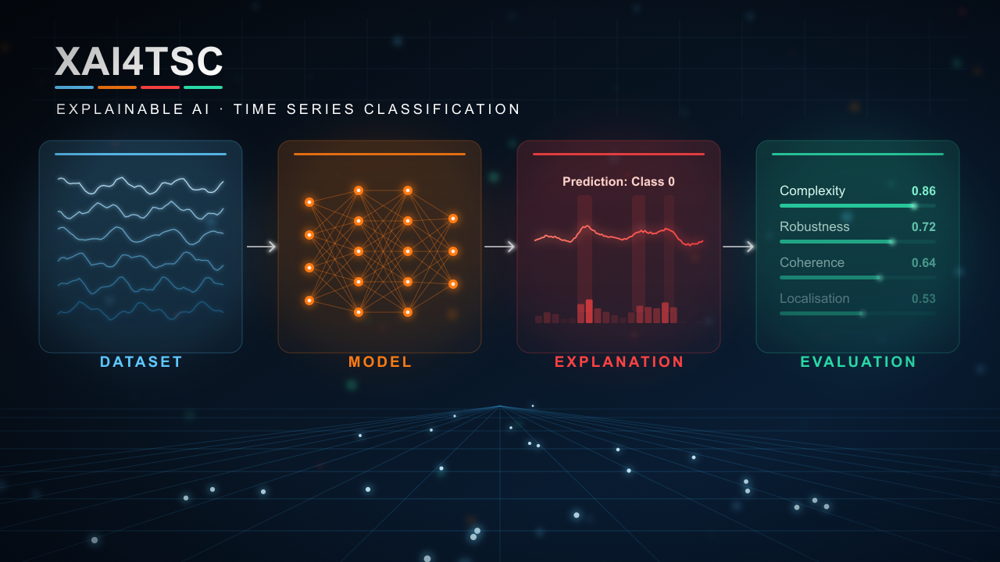

[](https://badge.fury.io/py/xai4tsc)
[](https://github.com/TimeXAIgroup/XAI4TSC/actions/workflows/docs.yml)

XAI4TSC is an evaluation framework for eXplainable AI (XAI) methods applied to Time Series Classification
(TSC). It supports an end-to-end pipeline to pick datasets, train models, generate explanations and evaluate them. XAI4TSC is developed by the TimeXAI Research Group and has two independent use cases:

- **Standalone experiment runner**: Clone the repo, choose or adapt a YAML config, run experiments from
  the command line.
- **Importable Python package**: `pip install xai4tsc` and use the public API in your own code,
  notebooks, or scripts.

The documentation can be found here: https://timexaigroup.github.io/XAI4TSC/

---

## Installation

### Standalone (experiment runner)

We use [uv](https://docs.astral.sh/uv/) for package management. It installs a matching Python (3.12 or 3.13) if needed:

```bash
git clone https://github.com/TimeXAI-group/XAI4TSC.git
cd XAI4TSC
uv sync --group runner        # creates .venv from uv.lock
source .venv/bin/activate
```

Without uv, `pip install -e . --group runner` (pip 25.1 or newer) in a Python 3.12 or 3.13 environment installs the same version ranges, without the lockfile.

### Package only

```bash
pip install xai4tsc
```

Or, for a local/editable install from a clone:

```bash
pip install -e PATH/TO/REPOSITORY
```
---

## Project layout

```
xai4tsc/
├── experiment_runner/          # Standalone CLI — owns all config and orchestration logic
│   ├── __main__.py             # Entry point: python -m experiment_runner --conf ...
│   ├── main.py                 # Pipeline orchestration and the CLI
│   ├── config.py               # Config loading, validation, defaults
│   ├── cache.py                # Runner-level split caching helpers
│   ├── explain.py              # Runner adapter for xai4tsc.xai
│   ├── evaluate.py             # Runner adapter for xai4tsc.evaluation
│   ├── log_setup.py            # Logging setup for the standalone runner
│   ├── utils.py                # Pure runner helpers (wildcard expansion, result rows)
│   └── configs/
│       ├── master.yaml         # Annotated reference — all available options and defaults
│       ├── example.yaml        # Go-to demo: synthetic data, time-domain explainers + metrics
│       ├── example_frequency.yaml  # Frequency / time-frequency showcase (FreqRISE, freq metrics)
│       ├── ucr_benchmark.yaml  # Full UCR sweep (LeNet + Integrated Gradients + Complexity)
│       └── uea_benchmark.yaml  # Full UEA sweep (skips OOM-risky datasets)
│
└── src/xai4tsc/                # Importable package
    ├── data/
    │   ├── datasets.py         # UcrUeaDataset, LocalDataset, SyntheticDataset
    │   └── ...                 # base classes, data loaders
    ├── models/                 # ModelBase, built-in models, catalog
    ├── xai/                    # Explainer ABC, generate_explanation(), built-in explainers
    ├── evaluation/             # evaluate(), Quantus metric catalog
    └── utils/                  # Shared utilities 
```

---

## Running an experiment

Run the runner as a module from the repository root:

```bash
python -m experiment_runner --conf experiment_runner/configs/example.yaml
python -m experiment_runner --conf experiment_runner/configs/example.yaml --debug
```

Four ready-to-run configs ship under `experiment_runner/configs/`:

- `example.yaml` — the go-to demo (and the default when `--conf` is omitted):
  the synthetic `Synth_Multilabel_Freq` dataset, two models, and time-domain
  explainers and metrics. Needs no download, and nothing to generate by hand -
  the dataset is generated on first use and cached.
- `example_frequency.yaml` — the same dataset explained with FreqRISE in the
  frequency and time-frequency domains, scored with the frequency metrics.
- `ucr_benchmark.yaml` / `uea_benchmark.yaml` — full-archive sweeps with a
  minimal model/explainer/metric stack.

Edit or copy any of them to configure datasets, models, explainers, and metrics.
`master.yaml` contains annotated documentation for every available option.

---

## Using XAI4TSC as a package

See our [Getting Started Example](examples/getting_started.py).

---

## Contributing

Contributions are welcome. See [`CONTRIBUTING.md`](CONTRIBUTING.md) for the
development setup, code style and quality gate, testing conventions, and the
pattern for adding a new model, explainer, or metric. The project is released
under the [MIT License](LICENSE); third-party code adapted into it is listed in
[`THIRD_PARTY_LICENSES.md`](THIRD_PARTY_LICENSES.md).

---

## Disclaimer

XAI4TSC bundles **re-implementations** of models, explainers, and
metrics from the research literature, alongside thin wrappers around third-party
libraries (Captum, Quantus). These implementations have **not** been verified by
the original authors and may differ from the source papers or reference code in
ways that affect results.

Evaluation scores are an empirical, sometimes contested, proxy for explanation
quality — treat them as guidance, not ground truth. When using XAI4TSC for
research, cite the original papers, state which implementation you used, and,
where possible, validate against a reference implementation. See the
[full disclaimer](docs/source/disclaimer.md) in the documentation for details.
